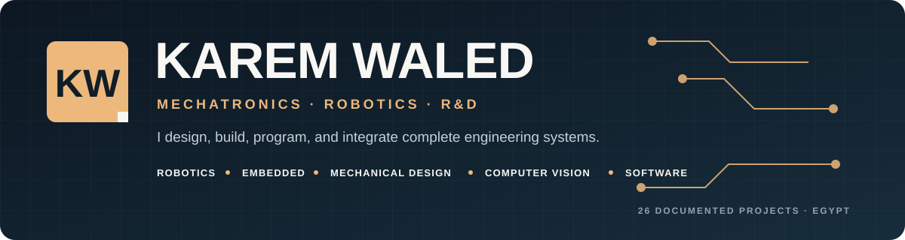

  

  <a href="https://karemwaledsa.github.io/"><strong>Portfolio</strong></a> ·
  <a href="https://www.linkedin.com/in/karemwaled/"><strong>LinkedIn</strong></a> ·
  <a href="mailto:karemwaledmay@gmail.com"><strong>Email</strong></a>

## Hello, I'm Karem Waled

**Mechatronics & Robotics Engineer | R&D | Embedded and Software Integration**

I build systems at the intersection of **mechanical design, embedded control, and software**. My work includes humanoid-robot integration, STM32 firmware, physical automation prototypes, computer-vision applications, mobile products, and business-software workflows.

My engineering approach is system-level: understand the mechanism, connect the sensors and actuators, write the control or application logic, then integrate and document the complete workflow. I am preparing for graduate study in robotics and intelligent systems while developing practical foundations in **ROS 2, SLAM, and Nav2**.

## Engineering Focus

- **Robotics & Integration:** physical prototyping, joint calibration, motion firmware, ROS fundamentals, URDF, MoveIt, and OpenCV experiments.
- **Embedded Systems & Control:** C/C++, STM32, AVR, Arduino, ESP32/ESP8266, peripheral drivers, sensors, motors, UART, SPI, I2C, and RTOS concepts.
- **Mechanical Design & R&D:** SolidWorks parts and assemblies, sheet metal, engineering drawings, rapid iteration, and electromechanical integration.
- **Software & Applied AI:** Python, OpenCV, Flutter, Node.js, PostgreSQL, Odoo, retrieval workflows, testing, Git, and Linux.

## Selected Engineering Work

| Project | Engineering contribution | Stack |
| --- | --- | --- |
| [InMoov Humanoid Robot — Case Study](https://karemwaledsa.github.io/projects/inmoov/) | Embedded motion and calibration work, subsystem integration, and ROS/OpenCV experiments within a team graduation project | ROS 1, Arduino, C++, OpenCV, URDF, MoveIt |
| [Robotics & Automation R&D](https://karemwaledsa.github.io/projects/industrial-prototypes/) | R&D, assembly, and integration across a PLC process station, motor trainer, mobile robots, and interactive robotic systems | PLC, Raspberry Pi, sensors, motor control |
| [STM32 Driver-Assistance System](https://github.com/KaremWaledSa/adas-stm32-safety-system) | Team-written layered firmware connecting sensing, vehicle modes, warnings, and motor outputs in Proteus simulation | STM32F401, Embedded C, UART, PWM, Proteus |
| [Computer Vision + ESP8266 Alert](https://github.com/KaremWaledSa/esp8266-image-processing-alert) | Connected pretrained object detection to a Flask API and a physical ESP8266 response device | Python, YOLOv5, Flask, ESP8266, HTTP |
| [AI Fitness Coach](https://github.com/KaremWaledSa/ai-fitness-coach-flutter) | On-device pose landmarks, joint-angle analysis, movement states, repetition counting, and bilingual feedback | Flutter, Dart, ML Kit, TTS |
| [Human-Reviewed RAG Assistant](https://github.com/KaremWaledSa/ai-customer-service-rag-assistant) | Full-stack retrieval and response workflow with a human approval step and automated tests | Node.js, PostgreSQL, pgvector, Flutter |

## Professional Engineering Highlights

- Contributed to a life-size 3D-printed humanoid platform combining articulated motion, embedded actuation, perception experiments, and a ROS-based mobile system.
- Worked across four physical robotics and automation devices, with responsibility for R&D, assembly, subsystem integration, and practical troubleshooting.
- Developed Odoo customer-service and delivery workflows using Python business logic, XML views, relational models, permissions, and validation.
- Built and taught practical embedded and robotics projects using Arduino, Raspberry Pi, ESP platforms, C/C++, and Python.

## Current Development

I am building a reproducible [ROS 2 mobile-robot learning project](https://github.com/KaremWaledSa/ros2_autonomous_mobile_robot) around mapping, localization, navigation, and waypoint missions. The repository currently documents environment setup and the staged implementation plan; Nav2 and SLAM work are presented as active learning rather than completed expertise.

## Background

- **B.Sc. in Mechatronics Engineering** — Ain Shams University, 2017–2022
- **Graduation project:** InMoov autonomous humanoid robot — Excellent
- **NTI Embedded Software Intensive Diploma** — 2023
- Experience in mechatronics R&D, embedded integration, ERP development, and robotics education

## More Work

- [Full engineering portfolio](https://karemwaledsa.github.io/)
- [Odoo ERP workflow case studies](https://github.com/KaremWaledSa/odoo-erp-workflow-modules)
- [Assistive communication glove](https://github.com/KaremWaledSa/smart-blind-assist-glove)
- [Six-relay ESP8266 controller](https://github.com/KaremWaledSa/esp8266-6relay-web-controller)
- [Kingdom of Steps mobile application](https://github.com/KaremWaledSa/kingdom-of-steps)

## Let's Connect

I am open to graduate research opportunities, robotics and mechatronics roles, and engineering collaborations.

- **Portfolio:** [karemwaledsa.github.io](https://karemwaledsa.github.io/)
- **LinkedIn:** [linkedin.com/in/karemwaled](https://www.linkedin.com/in/karemwaled/)
- **Email:** [karemwaledmay@gmail.com](mailto:karemwaledmay@gmail.com)

Robotics · Embedded Systems · Mechanical Design · Applied Software

